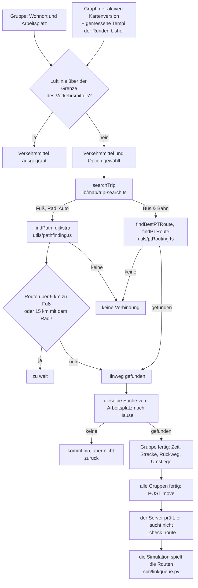
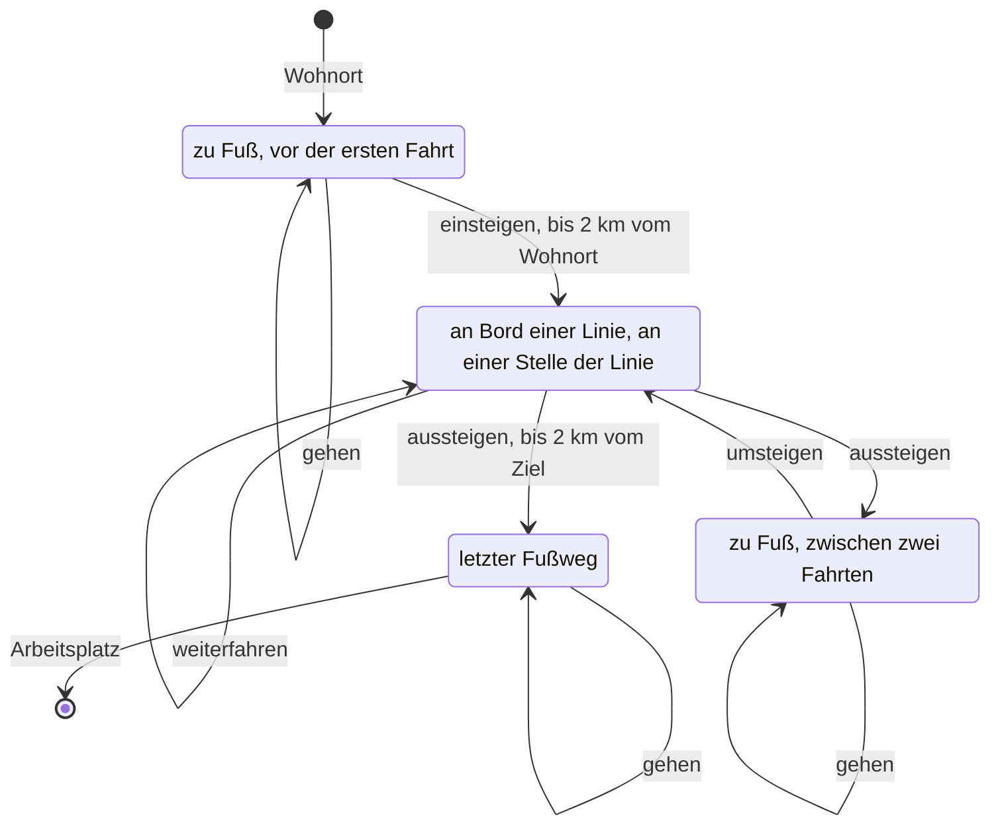
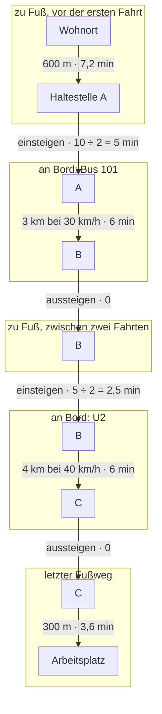
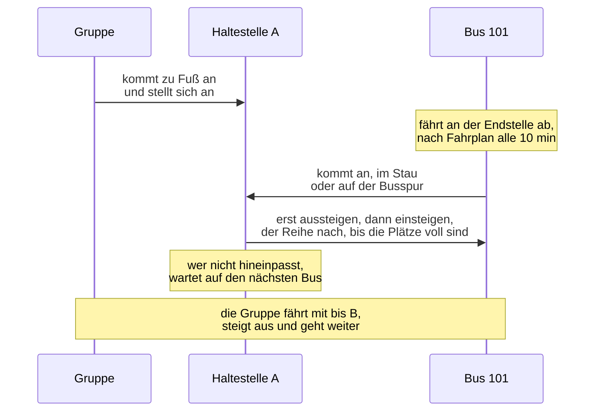
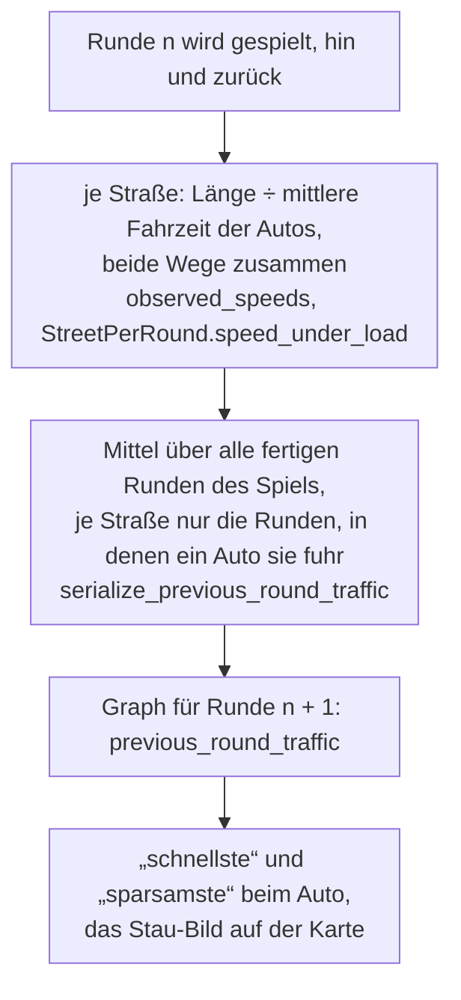

# Die Routensuche

Wie das Spiel den Weg einer Gruppe findet, zu Fuß, mit dem Rad, mit dem Auto und mit Bus & Bahn:
was die Suche liest, wie sie rechnet, was sie zurückgibt, was der Server prüft und was die
Simulation danach daraus macht. Dateien und Funktionen stehen mit Namen dabei, keine Zeilennummer:
`grep` findet sie. Den Ablauf im Zusammenhang mit allem anderen zeigt `docs/de-flowcharts.md`,
Abschnitt „Routensuche im Browser“; warum das Modell so rechnet, `docs/de-hintergrund.md`.

Fuß, Rad und Auto sind eine gewöhnliche kürzeste-Wege-Suche (Dijkstra) über die Straßen, mit
einem eigenen Gewicht je Verkehrsmittel. Beim Auto entscheidet die gewählte Option, was „kurz“
heißt. Bus & Bahn ist eine eigene Suche, die neben dem Ort auch weiß, ob man gerade geht oder in
welcher Linie man sitzt. Beide Suchen schätzen nur: Wie lange eine Fahrt wirklich dauert, stellt
erst die Simulation fest.

## Überblick

## Ein Router, im Browser

Gesucht wird auf dem Handy, nicht auf dem Server. Der Rundenbildschirm (`hooks/use-round-draft.ts`)
ruft für jede Gruppe `searchTrip` in `frontend/src/lib/map/trip-search.ts` auf. Das ist die einzige
Tür: Bus & Bahn geht an `findBestPTRoute` (`utils/ptRouting.ts`), alles andere an `findPath`
(`utils/pathfinding.ts`).

Dieselbe Tür benutzt die Kalibrierung. `manage.py calibrate_map` startet über `game/measure.py` das
Skript `frontend/scripts/routes.mjs`, das den TypeScript-Code unter Node laufen lässt
(`routeCommutes`): jeder Wohnort zu jedem gespielten Arbeitsplatz, hin und zurück, mit dem Auto und
mit Bus & Bahn, den beiden Verkehrsmitteln, die eine Kalibrierung spielt (`PLAYED_MODES`). Eine
Karte wird also mit genau den Routen gemessen, die eine Klasse bekäme. Einen zweiten Router in
Python gibt es absichtlich nicht: Zwei Router wären zwei Antworten darauf, welchen Weg eine Klasse
nimmt. Die Kalibrierung fragt mit den Voreinstellungen des Bildschirms
(`DEFAULT_CAR_OPTIMIZATION` „schnellste“, `DEFAULT_PT_OPTIMIZATION` „schnellste“) und ohne
gemessene Tempi, denn sie spielt kein Spiel.

## Woraus gesucht wird: der Graph

Der Bildschirm lädt den Graphen der Kartenversion, auf der das Spiel gerade steht
(`useMapGraph` in `lib/queries/map-graph.ts`, serviert von `MapVersionGraphView`). `withLines`
ergänzt, was die Router immer lesen: leere Linienlisten auf einer Karte ohne Linien, den Maßstab.

- **Knoten** haben eine Lage (x, y) und Typen: `home` (Wohnort), `workplace` (Arbeitsplatz),
  `station` (Bahnhof), `bus_stop` (Haltestelle). Ein Knoten kann mehrere Typen haben.
- **Kanten sind gerichtet.** Eine Straße in beide Richtungen sind zwei Kanten, eine Einbahnstraße
  ist eine. Beide Router gehen eine Kante nur in ihrer Richtung (`buildAdjacencyList`).
- **Eine Kante ist so lang wie ihre Straße**: `distance_m`, die Luftlinie × Maßstab der Karte ×
  `circuity` (Straße durch Luftlinie). Beide Router lesen diese Länge, die Simulation auch. Fehlt
  sie, rechnet der Router mit der Luftlinie × Maßstab.
- **Wer eine Kante benutzen darf**, sagt `canUseEdge` in `lib/map/edge-rules.ts`, eine Kopie der
  Regel der Simulation (`open_to_cars` in `sim/state.py`), nie lockerer als sie:
  - zu Fuß: jede Kante, auf der `walking` nicht ausdrücklich `false` ist;
  - Rad: jede Kante, auf der `biking` nicht ausdrücklich `false` ist. Ein Radweg (`bike_lane`) ist
    Infrastruktur, kein Recht: Er erlaubt nichts, was `biking` verbietet;
  - Auto: nur eine Straße mit mindestens einer Autospur. `lanes` zählt die ganze Straße; eine
    Busspur, ein Radweg und ein eigenes Tramgleis nehmen je eine Spur weg. Bleibt keine, ist die
    Straße eine Sperre: zu für Autos, offen für Bus, Tram, Rad und Fuß. Ein Weg (`"type": "path"`)
    hat keine Straße darunter und ist nie fürs Auto.

  Gleise sind beim Import für Fuß und Rad gesperrt, wenn die Datei nichts anderes sagt
  (`maps/importer.py`).
- **Linien**: `bus_lines` und `train_lines`. Eine Tram ist eine Bahnlinie mit `kind` „tram“. Jede
  Linie bringt ihren Takt (`interval`, Minuten), ihre Plätze, ihr Tempo (`speed_kmh`), ihre Kanten
  in Fahrtrichtung und `stops`: **jeden Knoten, den sie durchfährt**, in Reihenfolge, nicht nur ihre
  Haltestellen (`_stops_in_travel_order` in `maps/serializer.py`, dieselbe Kette `sim.node_chain`,
  mit der die Simulation die Fahrzeuge fahren lässt). Eine Kartenversion, die eine Straße ändert,
  führt die Linie über den Klon; welche Kanten eine Linie in welcher Version fährt, steht in ihren
  Zeilen dieser Version.
- **`previous_round_traffic`**: die gemessenen Autotempi der Runden bisher, je Straße. Mehr dazu
  unter „Die Tempi der Runden bisher“.

## Vor der Suche: die Luftlinie

Bevor jemand etwas wählt, rechnet der Bildschirm für jede Gruppe die Luftlinie vom Wohnort zum
Arbeitsplatz (`airDistanceM` in `lib/map/trip-limits.ts`). Ist sie schon länger als **5 km**, ist
„zu Fuß“ ausgegraut, ab **15 km** das Rad. Das ist sicher: Keine Route ist kürzer als die
Luftlinie, die Prüfung verbietet also nur, was ohnehin nicht ginge. Die echte Grenze prüft danach
die gefundene Route.

Auto und Bus & Bahn haben keine Grenze. Sie bezahlen ihren Weg in CO₂, Euro und Minuten, und das
sind die Währungen, über die die Klasse streitet. Fuß und Rad kosten nichts davon; das einzige
Argument gegen drei Stunden Fußweg ist, dass sie niemand geht. Die Grenzen sind Strecken, keine
Zeiten: 5 km zu Fuß sind bei 5 km/h eine Stunde, 15 km mit dem Rad bei 20 km/h 45 Minuten, die
engere der beiden mit Absicht, weil niemand von Tür zu Tür 20 km/h hält.

## Zu Fuß und mit dem Rad

Eine kürzeste-Wege-Suche (`dijkstra` in `utils/pathfinding.ts`), das Gewicht einer Kante ist ihre
Zeit in Minuten:

| Verkehrsmittel | Gewicht je Kante | Tempo |
|---|---|---|
| zu Fuß | Länge ÷ 5 km/h | `FALLBACK_WALK_SPEED_KMH` |
| Rad | Länge ÷ 20 km/h | `FALLBACK_BIKE_SPEED_KMH` |

Bei festem Tempo ist die schnellste Route die kürzeste. Ein Radweg macht das Rad nicht schneller,
und ein Autostau bremst es nicht; so rechnet auch die Simulation. Ist die gefundene Route länger
als 5 km zu Fuß oder 15 km mit dem Rad, gibt `findPath` „zu weit“ zurück (`TOO_FAR`), mit einem
eigenen Satz auf dem Bildschirm: Hier hilft kein anderer Weg, nur ein anderes Verkehrsmittel.

Der Router rechnet mit 5 und 20 km/h aus `lib/constants.ts`. Die Simulation liest die Tempi der
Karte (`GameMap.walk_speed_kmh`, `bike_speed_kmh`); auf jeder bisherigen Karte und in jeder
gebauten sind es dieselben 5 und 20.

## Mit dem Auto

Dieselbe Suche, über die Kanten mit Autospur. Was eine Kante kostet, hängt an der Option, die die
Gruppe gewählt hat (`calculateEdgeWeight` in `utils/pathfinding.ts`):

| Option | im Code | Gewicht je Kante | liest die Tempi der Runden bisher |
|---|---|---|---|
| „schnellste“ | `time` | Minuten beim gemessenen Tempo | ja |
| „kürzeste“ | `distance` | Meter | nein |
| „sparsamste“ | `co2` | Meter × CO₂-Faktor beim gemessenen Tempo | ja |

**Das gemessene Tempo** einer Straße ist ihr Mittel über die bisherigen Runden des Spiels
(`previous_round_traffic`). Ist eine Straße noch nie gefahren worden, und in Runde 1 gilt das für
alle, zählt ihr Tempolimit, und hat sie keins, 50 km/h (`FALLBACK_CAR_SPEED_KMH`). „Kürzeste“
fragt nie nach dem Tempo: Ein Stau ändert keine Strecke.

**Der CO₂-Faktor** ist die Kurve der Simulation, `EF(v) = a/v + b + c·v²` (COPERT/HBEFA-Form), als
Verhältnis zu 50 km/h (`carEmissionFactor` in `lib/map/car-emissions.ts`, das Gegenstück zu
`car_emissions_g_per_km` in `sim/constants.py`). Im Stau stößt ein Auto je Kilometer mehr aus,
weil es länger läuft; am wenigsten bei 70 km/h, darüber wieder etwas mehr. Der Faktor endet bei
2,00, das greift unter 9,2 km/h:

| Tempo | 10 | 15 | 20 | 30 | 40 | 50 | 70 | 100 | 130 km/h |
|---|---|---|---|---|---|---|---|---|---|
| Faktor | 1,90 | 1,51 | 1,32 | 1,13 | 1,04 | 1,00 | 0,97 | 1,01 | 1,10 |

`tests/utils/traffic-routing.test.ts` hält die Zahlen der Browser-Kopie an die des Servers.

### Ein Beispiel

Zwei Wege zur Arbeit, beide auf Straßen mit Tempo 50. Weg A ist 3 km lang, war in den Runden bisher
aber im Mittel nur 15 km/h schnell. Weg B ist 4 km lang und lief mit 40 km/h.

| | Weg A: 3 km, gemessen 15 km/h | Weg B: 4 km, gemessen 40 km/h | gewählt |
|---|---|---|---|
| „schnellste“ | 12 min | 6 min | B |
| „kürzeste“ | 3 000 m | 4 000 m | A |
| „sparsamste“ | 3 000 × 1,51 = 4 530 | 4 000 × 1,04 = 4 160 | B |

In Runde 1 gibt es noch keine Messung. Eine 2 km lange Tempo-30-Straße gegen einen Umweg von
2,5 km mit Tempo 50: „schnellste“ nimmt den Umweg (3,0 gegen 4,0 min), „sparsamste“ die
Tempo-30-Straße (2 000 × 1,13 = 2 260 gegen 2 500 × 1,00 = 2 500).

### Was die Suche beim Auto nicht kennt

Abbiegen kostet nichts, Ampeln gibt es nicht (der Stau steht im Modell für sie), und jede Kante ist
in ihrer Richtung erlaubt. Was die anderen Gruppen in dieser Runde wählen, weiß niemand: Alle
suchen auf den Messungen der Runden davor. Wählen alle dieselbe freie Straße, ist sie in dieser
Runde voll; dass das Mittel über alle Runden zählt und nicht die letzte allein, dämpft genau dieses
Hin und Her.

## Mit Bus & Bahn

Die Suche muss mehr wissen als den Ort. An derselben Haltestelle zu stehen oder in der U2 durch sie
hindurchzufahren sind zwei verschiedene Lagen: Aus der einen kann man in jede Linie steigen, aus
der anderen nur weiterfahren oder aussteigen. `findPTRoute` sucht deshalb über **Zustände**: einen
Knoten und die Art, wie man gerade unterwegs ist. Gewicht ist überall die geschätzte Zeit in
Minuten.

### Die vier Arten, unterwegs zu sein

Im Code ist das `ProductMode`: `walk` mit `hasBoarded` und `last`, oder `pt` mit der Linie
(`lineId` **und** `lineType`, denn Bus 2 und Bahn 2 sind verschiedene Linien), der Stelle auf der
Linie (`at`, ein Index in ihre `stops`) und `rode`, ob das Fahrzeug die Einstiegshaltestelle
schon verlassen hat. Die Suche endet erst, wenn sie den Arbeitsplatz im Zustand „letzter Fußweg“
erreicht. Eine Route aus Bus & Bahn hat deshalb immer mindestens eine Fahrt.

### Was ein Schritt kostet

| Schritt | Kosten | Bedingung |
|---|---|---|
| eine Kante gehen | Länge ÷ 5 km/h | `walking` nicht `false` |
| einsteigen | Takt ÷ 2, die erwartete Wartezeit | an einem Einstiegspunkt (unten); die erste Fahrt nur bis 2 km vom Wohnort; bei „wenig umsteigen“ ab der zweiten Fahrt + 30 min; bei „ohne Bus“ nie in einen Bus |
| eine Kante weiterfahren | Länge ÷ Tempo der Linie | auf der Linie, von der Stelle `at` zur nächsten |
| am Ende eines Rings weiter | Takt ÷ 2 | die Linie endet, wo sie anfängt |
| aussteigen | 0 | erst wenn das Fahrzeug losgefahren ist, an einem Einstiegspunkt |
| in den letzten Fußweg aussteigen | 0 | wie oben, und nur bis 2 km vom Arbeitsplatz |

Die Länge einer Fahrt ist die Länge ihrer Kanten (`distance_m`), so lang, wie die Simulation sie
fährt, nicht die Luftlinie zwischen zwei Haltestellen, die eine gebogene Strecke abkürzen würde.
Das Tempo einer Linie ist fest: ohne gesetzten Wert Bus 30 km/h, Bahn 40, Tram 30. Die Wartezeit
ist ein Erwartungswert: Wer zu einer zufälligen Zeit an die Haltestelle kommt, wartet im Mittel
einen halben Takt.

### Wo man ein- und aussteigt

An jedem Knoten mit dem Typ `station` oder `bus_stop`, und an jedem Knoten, den **zwei
verschiedene Linien** teilen: Dort steigt man um, auch wenn niemand ihn als Haltestelle markiert
hat. Eine Linie und ihr Rückweg zählen dabei als eine Linie, denn eine in beide Richtungen
gezeichnete Linie sind zwei Zeilen, `101` und `101 reverse` (`lineOf`). Sonst wäre jede Kreuzung
zwischen zwei Haltestellen, an der Hin- und Rückweg vorbeikommen, eine Tür. An einem Knoten, den
nur eine Linie durchfährt und der keine Haltestelle ist, kann man nicht aus- und weiter vorne
wieder einsteigen.

Aussteigen geht erst, wenn das Fahrzeug die Einstiegshaltestelle verlassen hat (`rode`).
Einsteigen und sofort wieder aussteigen wäre ein Fußweg mit einer Wartezeit darin, und wer
„Bus & Bahn“ gewählt hat, bekommt keinen Fußweg.

### Die 2-km-Regel

Bevor die Suche läuft, geht `walkReachabilitySet` vom Wohnort 2 km weit über alle begehbaren
Kanten, und vom Arbeitsplatz 2 km rückwärts, also auf den Kanten, die **zu** ihm führen. Gemessen
wird den Weg entlang, nicht die Luftlinie (`PT_MAX_WALK_DISTANCE_M`, 2 000 m).

- Einsteigen in die **erste** Fahrt geht nur an Einstiegspunkten im ersten Kreis.
- In den **letzten Fußweg** aussteigen geht nur an Einstiegspunkten im zweiten Kreis. Weil das in
  der Suche selbst steckt und nicht danach geprüft wird, findet sie auch die langsamere Linie, die
  nahe genug hält, wenn die schnellere zu weit weg absetzt.
- Ein Fußweg **zwischen** zwei Fahrten hat keine Grenze; er kostet nur Zeit.

Gibt es in einem der beiden Kreise keinen Einstiegspunkt, oder hält dort keine Linie, gibt die
Suche sofort auf. Sie weicht dann nie still aufs Gehen aus: Wer „Bus & Bahn“ gewählt hat, bekommt
die ehrliche Antwort, dass es keine Verbindung gibt.

### Ein Beispiel

Vom Wohnort sind es 600 m zu Haltestelle A. Dort fährt der Bus 101 alle 10 Minuten 3 km bis B. In
B hält die U2 alle 5 Minuten und fährt 4 km bis C, und von C sind es 300 m zur Arbeit. So liegt
diese Route in den Zuständen:

Zusammen 7,2 + 5 + 6 + 2,5 + 6 + 3,6 = **30,3 min**. Daneben fährt von A ein Bus 200 alle
20 Minuten ohne Umstieg 8 km bis D, und D liegt 200 m vor der Arbeit: 7,2 + 10 + 16 + 2,4 =
**35,6 min**.

- „schnellste“ nimmt die Route mit Umstieg: 30,3 gegen 35,6.
- „wenig umsteigen“ rechnet beim zweiten Einsteigen 30 Minuten dazu, 60,3 gegen 35,6, und nimmt den
  Bus 200.
- „ohne Bus“ findet hier nichts, wenn in 2 km vom Wohnort nur Busse halten: Bis zur U2 in B sind es
  zu Fuß mehr als 2 km.

### Die drei Optionen

| Option | im Code | was sie ändert |
|---|---|---|
| „schnellste“ | `fastest` | nichts, die geschätzte Zeit entscheidet |
| „wenig umsteigen“ | `fewest_transfers` | jedes Einsteigen nach dem ersten kostet in der Suche 30 Minuten mehr (`FEWEST_TRANSFERS_PENALTY_MIN`) |
| „ohne Bus“ | `no_bus` | Buslinien werden übersprungen; Trams sind Bahnlinien und bleiben erlaubt |

### Dieselbe Haltestelle zweimal, und Ringe

Eine Linie kann eine Haltestelle zweimal passieren: hinein zu einer Endstelle und wieder heraus,
oder einmal um eine Schleife (Bremens 94, die 58). Die Suche weiß deshalb, **wo auf der Linie** sie
ist (`at`), nicht nur an welchem Knoten. Wer beim zweiten Durchfahren einsteigt, fährt zum Ende der
Linie weiter, nicht noch einmal um die Schleife.

Eine Linie, die endet, wo sie anfängt, ist ein Ring (die S41): An ihrem Ende fährt das Fahrzeug
als nächste Abfahrt weiter, und wer sitzen bleibt, fährt mit. Die Suche rechnet dort wie beim
Einsteigen einen halben Takt Wartezeit; die Simulation lässt das Fahrzeug bis zur nächsten
Abfahrt nach Fahrplan stehen.

### Was zurückkommt

`reconstructPath` geht die Zustände rückwärts ab und teilt die Route in drei Teile: den Fußweg zur
ersten Haltestelle (`walkToStation`), die Fahrten mit den Fußwegen zwischen ihnen (`ptSegments`)
und den Fußweg von der letzten Haltestelle (`walkFromStation`). `toLeg` hängt sie wieder
aneinander. Jeder Fahrtabschnitt trägt seine Kante, sein Verkehrsmittel („bus“ oder „train“) und
die Linie. Die Zeit ist die Summe aller Abschnitte plus der Wartezeiten.

## Der Rückweg

Der Rückweg ist eine eigene Suche, vom Arbeitsplatz nach Hause, mit demselben Verkehrsmittel und
derselben Option, nie der Hinweg umgedreht: Auf einer Karte mit Einbahnstraßen ist er eine andere
Route, und eine Linie fährt zurück auf ihrer eigenen Seite. Findet die Suche hin, aber nicht
zurück, sagt der Bildschirm genau das: „Die Gruppe kommt hin, aber nicht wieder nach Hause.“
(`NO_WAY_HOME`).

## Was der Bildschirm zeigt

Unter jeder Gruppe stehen Zeit, Strecke, die Zeit des Rückwegs und bei Bus & Bahn die Zahl der
Umstiege (`RouteSummary` in `components/round/route-summary.tsx`; Umstiege sind die Wechsel der
Linie zwischen zwei Fahrtabschnitten, `transferCount`). CO₂ steht dort absichtlich nicht: Das
rechnet die Simulation nach der Runde, und eine Zahl hier wäre eine zweite, schlechtere Antwort.

Die angezeigte Zeit ist eine Schätzung, je Verkehrsmittel anders gerechnet:

- zu Fuß und Rad: Strecke bei 5 und 20 km/h.
- Auto: jede Kante bei ihrem **Tempolimit**, auch bei „schnellste“. Das gemessene Tempo wählt die
  Route aus, in die angezeigte Zeit geht es nicht ein.
- Bus & Bahn: Fußwege, Fahrten und die Wartezeiten, wie die Suche sie gewichtet hat; bei
  „wenig umsteigen“ also mit den 30 Minuten je Umstieg.

Der Server nimmt die Schätzung mit (`estimated_time_min`), braucht sie aber nur als Ersatz für eine
Route, die nicht gespielt wurde. Was in der Auswertung steht, hat die Simulation gemessen.

Die Route ist sofort da: Eine Suche auf diesen Karten dauert Millisekunden. Die Karte spielt danach
ab, welche Kanten die Suche der Reihe nach angesehen hat (`lib/map/search-trace.ts`), nur für den
Hinweg, als Bild zur Route, nicht als Wartezeit. Jede Suche trägt eine laufende Nummer je Gruppe;
kommt eine langsame Suche an, nachdem schon eine neuere gestartet ist, wird sie verworfen. Was eine
Gruppe angetippt hat (Verkehrsmittel und Option, nie die Route), überlebt ein Neuladen im
`localStorage` (`lib/game/draft-storage.ts`).

Findet die Suche nichts, steht dort einer von drei Sätzen: zu weit (Fuß, Rad), kommt hin, aber
nicht zurück, oder „Auf diesem Weg kommt die Gruppe nicht ans Ziel. Nimm eine andere Linie.“ mit
„nochmal versuchen“.

## Was der Server prüft

Der Server sucht keine Route, er prüft die geschickte (`_validate_routes` und `_check_route` in
`game/views_rest.py`), Hinweg und Rückweg nach denselben Regeln:

- Der erste Abschnitt beginnt am Wohnort der Gruppe, der letzte endet an ihrem Arbeitsplatz; der
  Rückweg umgekehrt. Jede Gruppe hat ihren eigenen Wohnort (`agent_assignments`).
- Jeder Abschnitt beginnt, wo der vorige endet, und jede Kante gibt es.
- Fuß, Rad und Auto gehen jede Kante **in ihrer Richtung**. Ein Auto gegen die Einbahnstraße wird
  abgelehnt.
- Fuß und Rad nur, wo `walking` und `biking` es erlauben; das Auto nur auf einer Straße, die nach
  Busspur, Radweg und eigenem Tramgleis noch eine Autospur hat.
- Bei Bus- und Bahnabschnitten prüft er weder Richtung noch Erlaubnis; Kante `-1` ist für Fuß-,
  Bus- und Bahnabschnitte ohne eigene Kante erlaubt.

## Was die Simulation daraus macht

Die Simulation (`sim/linkqueue.py`) fährt die geschickten Routen Kante für Kante ab, erst morgens
hin, dann abends zurück auf einem frischen Netz. Unterwegs wird nicht neu gesucht.

**Auto**: Es fährt genau seine Kanten, in der Warteschlange der Straße. Wie lange es braucht,
entscheidet der Stau: Freifluss, Kapazität und Stauraum jeder Straße, das Wunschtempo jeder Person
(einmal gezogen), wer von der Ausfahrt aus Vorfahrt gewähren muss, der Kreisverkehr. Das Tempo, das
die Suche angenommen hat, spielt keine Rolle mehr.

**Fuß und Rad**: mit ihrem Tempo, ein Autostau bremst sie nicht.

**Bus & Bahn**: Hier wird die Schätzung der Suche durch das ersetzt, was wirklich passiert.

1. **Die Route wird in Fahrten geteilt** (`_rides_on`): aufeinanderfolgende Abschnitte derselben
   Linie sind eine Strecke; daraus wird jede Fahrt mit Einstiegsknoten **und** der Stelle auf der
   Linie (`PTLeg.board_stop`). Von mehreren Stellen, an denen die Fahrt beginnen könnte, gewinnt
   die, von der aus sie am weitesten fährt.
2. **Abfahrt von zu Hause**: Jede Person der Gruppe will zu einer gezogenen Minute los, normalverteilt
   um die Abfahrtsstunde, abends 1,6-mal so breit gestreut wie morgens.
3. **An der Haltestelle**: Die Person stellt sich in die Schlange ihrer Linie an diesem Knoten.
   Wer auf die M1 wartet, steigt nicht in die U7.
4. **Der Fahrplan**: Die Fahrzeuge einer Linie verlassen die Endstelle zu festen Minuten, alle
   `interval` Minuten ab Beginn des zweistündigen Abfahrtsfensters. Kein Zufall: Ein Fahrplan ist
   keine Zufallszahl. Nach dem Fenster fährt jede Linie weiter, solange noch irgendwer unterwegs
   ist.
5. **Unterwegs**: Ein Bus steht im Autostau wie ein Auto (so groß wie drei Autos), außer auf einer
   Busspur. Eine Tram steht nur dort im Stau, wo ihr Gleis in der Autospur liegt. Eine U- oder
   S-Bahn fährt frei.
6. **An jeder Haltestelle**: erst aussteigen, dann einsteigen, der Reihe nach, bis die Plätze voll
   sind. Wer nicht hineinpasst, wartet auf das nächste Fahrzeug. Wer auf den anderen Durchgang der
   Linie wartet, lässt dieses Fahrzeug fahren.
7. **Aussteigen** an der geplanten Stelle, dann geht der Weg weiter: zu Fuß zur nächsten Linie oder
   zur Arbeit.

Die Wartezeit wird gemessen und **ausgewiesen, nicht addiert**: Die Uhr läuft seit der Minute, in
der die Person los wollte, das Stehen an der Haltestelle steckt also schon in der Fahrzeit.
Haltezeiten an der Haltestelle sind nicht modelliert.

## Die Tempi der Runden bisher

„schnellste“ und „sparsamste“ beim Auto, und das Stau-Bild auf der Karte, lesen dieselbe eine Liste:

- Gemessen werden nur Autos. Ein Fußgänger braucht über eine 900-m-Straße zehnmal so lange wie ein
  Auto; mitgezählt, hieße eine leere Straße Stau.
- Eine Straße, die kein Auto fuhr, hat keine Messung, nicht Tempo null. Die Suche nimmt dort das
  Tempolimit.
- **Das Mittel aller Runden, nicht die letzte allein.** Nach der letzten Runde allein schwang die
  Klasse hin und her: Alle verließen die Straßen, die gerade voll waren, und füllten die freien,
  die dann in der nächsten Runde voll waren. Auf Berlin Mitte-West ging das mittlere Autotempo so
  von Runde zu Runde um 8 bis 10 km/h auf und ab, auf einer gebauten Karte fiel es in Runde 2 von 26
  auf 1 km/h. Mit dem laufenden Mittel kommt die gelieferte Karte ab Runde 4 zur Ruhe.
- Der Bildschirm fragt den Graphen je Runde neu an; die Rundennummer steht im Schlüssel des
  Zwischenspeichers. Ein Bildschirm nach der Runde (Abstimmung, Diskussion) fragt schon unter der
  nächsten Runde (`trafficAfter`), damit er dieselben Tempi zeigt wie dann der Rundenbildschirm.

## Was die Suche nicht weiß

- **Keine Uhr.** Die Suche weiß nicht, wann jemand losgeht und wann der nächste Bus kommt; sie
  rechnet mit einem halben Takt. Die Simulation fährt den Fahrplan.
- **Kein Stau für Busse.** Die Suche rechnet eine Linie immer mit ihrem festen Tempo, auch wenn
  der Bus in der letzten Runde im Stau stand. Die gemessenen Tempi liest nur die Autosuche.
- **Keine Plätze.** Die Suche plant nie um einen vollen Bus herum.
- **Die anderen Gruppen.** Jede Gruppe sucht für sich, auf den Messungen der Runden davor.
- **Abbiegen und Ampeln.** Beides kostet nichts; der Stau steht für die Ampeln.

## Die Zahlen

| Zahl | Wert | wo |
|---|---|---|
| Gehtempo | 5 km/h | `FALLBACK_WALK_SPEED_KMH`, `lib/constants.ts` (Kopie von `sim/constants.py`) |
| Radtempo | 20 km/h | `FALLBACK_BIKE_SPEED_KMH`, ebenda |
| Autotempo ohne Tempolimit | 50 km/h | `FALLBACK_CAR_SPEED_KMH`, ebenda |
| CO₂-Kurve des Autos | 166,8 g/km bei 50 km/h, Minimum bei 70, Faktor höchstens 2,00 | `CAR_EMISSIONS_G_PER_KM`, `CAR_EF_*`, `MAX_CAR_EMISSION_FACTOR`, ebenda |
| längste Strecke zu Fuß | 5 km | `MAX_WALK_M`, nur `lib/constants.ts` |
| längste Strecke mit dem Rad | 15 km | `MAX_BIKE_M`, ebenda |
| Fußweg zur ersten und von der letzten Haltestelle | 2 km | `PT_MAX_WALK_DISTANCE_M`, ebenda |
| Aufschlag je Umstieg bei „wenig umsteigen“ | 30 min | `FEWEST_TRANSFERS_PENALTY_MIN`, `utils/ptRouting.ts` |
| erwartete Wartezeit | Takt ÷ 2 | `getNeighbours`, `utils/ptRouting.ts` |
| Linientempo ohne eigenen Wert | Bus 30, Bahn 40, Tram 30 km/h | `BusLine`, `TrainLine.DEFAULTS` in `maps/models.py` |

Woher die Zahlen des Modells kommen: `docs/de-zahlen.md`.

## Wo was steht

| Was | Datei | Name |
|---|---|---|
| die eine Tür | `frontend/src/lib/map/trip-search.ts` | `searchTrip`, `toLeg`, `routeCommutes` |
| Fuß, Rad, Auto | `frontend/src/utils/pathfinding.ts` | `findPath`, `dijkstra`, `calculateEdgeWeight` |
| Bus & Bahn | `frontend/src/utils/ptRouting.ts` | `findBestPTRoute`, `findPTRoute`, `getNeighbours`, `reconstructPath` |
| wer welche Kante darf | `frontend/src/lib/map/edge-rules.ts` | `canUseEdge`, `carLanes` |
| Grenzen und Luftlinie | `frontend/src/lib/map/trip-limits.ts` | `exceedsModeLimit`, `airDistanceM` |
| CO₂-Faktor | `frontend/src/lib/map/car-emissions.ts` | `carEmissionFactor` |
| der Rundenbildschirm | `frontend/src/hooks/use-round-draft.ts` | `useRoundDraft`, `findRoute` |
| Graph und Tempi | `frontend/src/lib/queries/map-graph.ts`, `backend/maps/serializer.py` | `useMapGraph`, `trafficAfter`, `serialize_previous_round_traffic` |
| Linien im Graphen | `backend/maps/serializer.py` | `serialize_bus_line_for_graph`, `serialize_train_line_for_graph` |
| die Prüfung | `backend/game/views_rest.py` | `_validate_routes`, `_check_route` |
| die Kalibrierung | `frontend/scripts/routes.mjs`, `backend/game/measure.py` | |
| Fahrten in der Simulation | `backend/sim/linkqueue.py` | `PTLeg`, `_rides_on`, `_serve_stop`, `_generate_departures` |

Tests: `frontend/tests/utils/pathfinding.test.ts`, `pt-routing.test.ts`, `traffic-routing.test.ts`,
`frontend/tests/lib/map/trip-search.test.ts`, `trip-limits.test.ts`; die Prüfung des Servers in
`backend/game/tests/test_rounds.py`.

## Was zusammen geändert wird

- **Router und Simulation**: Beide wissen, wo auf einer Linie jemand ist (`at` im Router,
  `PTLeg.board_stop` in der Simulation), und beide fahren einen Ring weiter. Wer das eine ändert,
  ändert das andere.
- **Wer eine Kante benutzen darf**: `canUseEdge` folgt der Simulation (`open_to_cars`), nie
  lockerer, sonst bietet der Bildschirm eine Route an, die der Server ablehnt.
- **Eine Zahl des Modells** (Tempi, CO₂-Kurve): `sim/constants.py` und `lib/constants.ts`
  zusammen; `tests/lib/constants.test.ts` sagt, wenn eine Seite vergessen wurde.
- **Diese Datei** mit `docs/en-route-search.md`.
