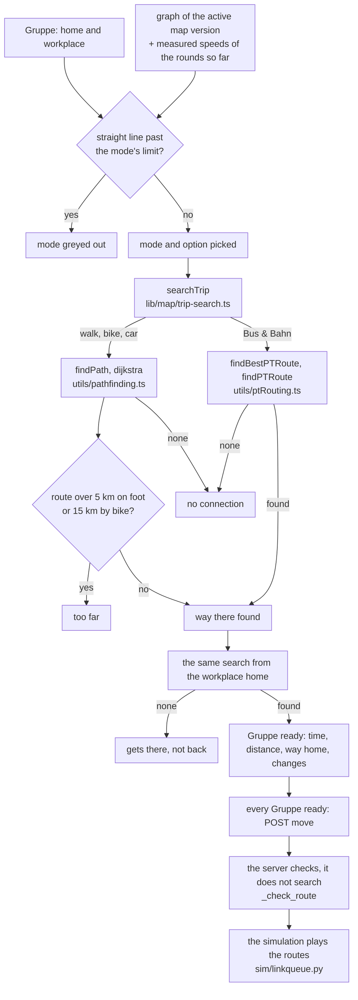
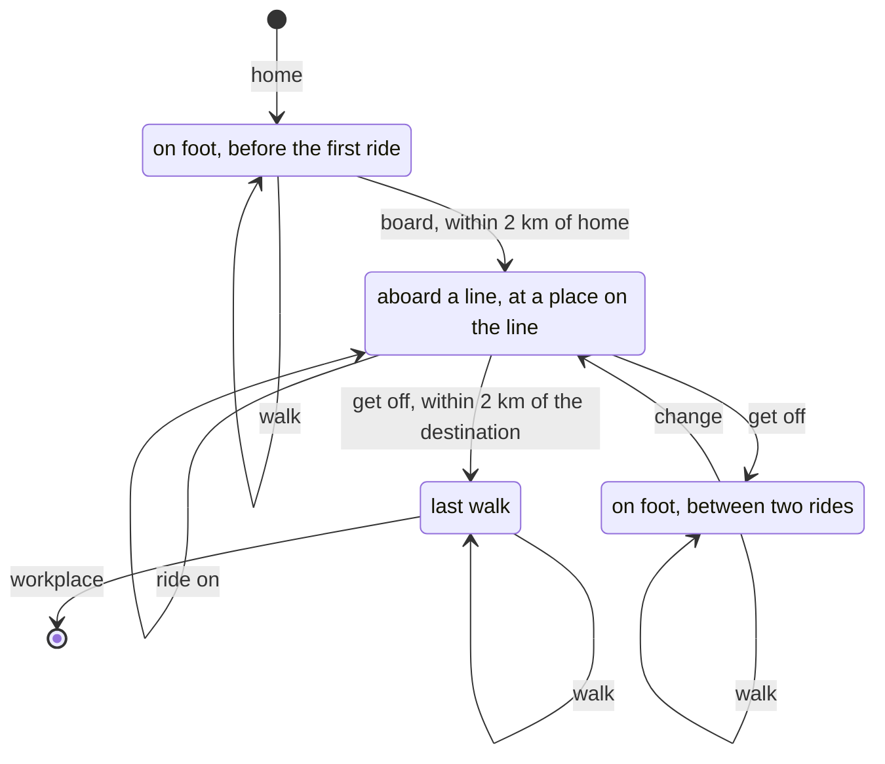
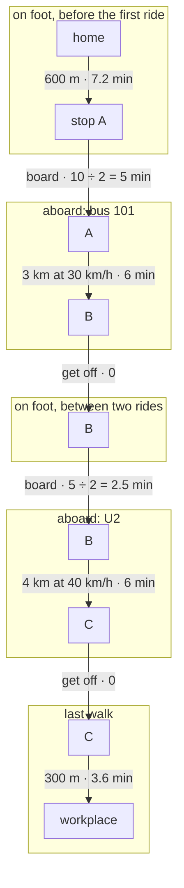
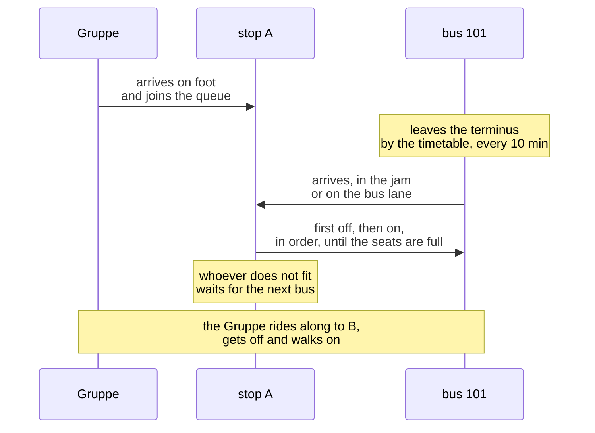
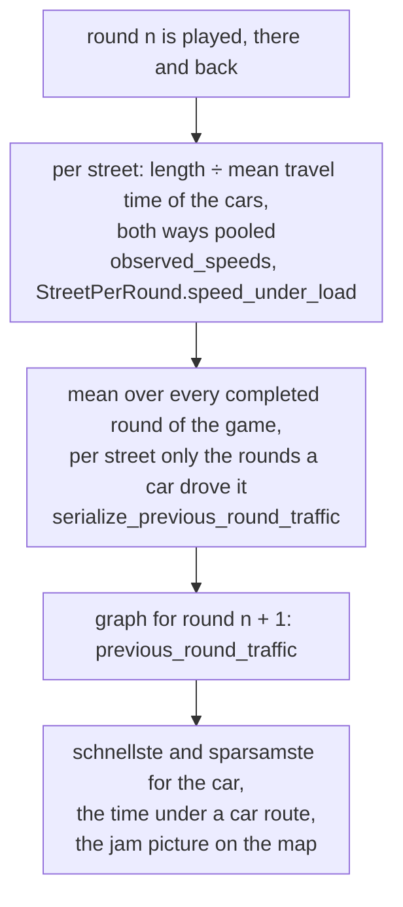

# The route search

How the game finds a Gruppe's way, on foot, by bike, by car and by Bus & Bahn: what the search
reads, how it weighs, what it returns, what the server checks and what the simulation then makes of
it. Files and functions are named, without line numbers: `grep` finds them. The flow in context
with everything else is in `docs/en-flowcharts.md`, section "Finding a route in the browser"; why
the model computes what it computes, in `docs/en-background.md`.

Walk, bike and car are an ordinary shortest-path search (Dijkstra) over the streets, with a weight
of their own per mode. For the car, the option picked decides what "short" means. Bus & Bahn is a
search of its own that knows, beside the place, whether one is walking or which line one sits in.
Both searches only estimate: how long a trip really takes is found by the simulation.

## Overview

## One router, in the browser

The search runs on the phone, not on the server. The round screen (`hooks/use-round-draft.ts`) calls
`searchTrip` in `frontend/src/lib/map/trip-search.ts` for every Gruppe. It is the only door: Bus &
Bahn goes to `findBestPTRoute` (`utils/ptRouting.ts`), everything else to `findPath`
(`utils/pathfinding.ts`).

The calibration uses the same door. `manage.py calibrate_map` starts, through `game/measure.py`, the
script `frontend/scripts/routes.mjs`, which runs the TypeScript code under Node (`routeCommutes`):
every home to every workplace played, there and back, by car and by Bus & Bahn, the two modes a
calibration plays (`PLAYED_MODES`). A map is measured with exactly the routes a class would be
given. There is no second router in Python on purpose: two routers would be two answers to which
way a class goes. The calibration asks with the screen's defaults (`DEFAULT_CAR_OPTIMIZATION`
"schnellste", `DEFAULT_PT_OPTIMIZATION` "schnellste") and without measured speeds, since it plays no
game.

## What is searched: the graph

The screen loads the graph of the map version the game is on now (`useMapGraph` in
`lib/queries/map-graph.ts`, served by `MapVersionGraphView`). `withLines` adds what the routers
always read: empty line lists on a map without lines, the scale.

- **Nodes** have a position (x, y) and types: `home`, `workplace`, `station`, `bus_stop`. A node can
  have several.
- **Edges are directed.** A two-way street is two edges, a one-way street one. Both routers take an
  edge only in its direction (`buildAdjacencyList`).
- **An edge is as long as its road**: `distance_m`, the straight line × the map's scale ×
  `circuity` (road over straight line). Both routers read this length, and so does the simulation.
  Where it is missing, the router uses the straight line × scale.
- **Who may use an edge** is `canUseEdge` in `lib/map/edge-rules.ts`, a copy of the simulation's
  rule (`open_to_cars` in `sim/state.py`), never laxer:
  - on foot: every edge whose `walking` is not explicitly `false`;
  - bike: every edge whose `biking` is not explicitly `false`. A bike lane (`bike_lane`) is
    infrastructure, not a right: it allows nothing `biking` forbids;
  - car: only a street with at least one car lane. `lanes` counts the whole street; a bus lane, a
    bike lane and a tram's own track each take one. With none left the street is a gate: closed to
    cars, open to bus, tram, bike and foot. A path (`"type": "path"`) has no street under it and is
    never for cars.

  Rails are closed to walking and cycling on import unless the file says otherwise
  (`maps/importer.py`).
- **Lines**: `bus_lines` and `train_lines`. A tram is a train line with `kind` "tram". Every line
  carries its interval (`interval`, minutes), its seats, its speed (`speed_kmh`), its edges in
  travel order, and `stops`: **every node it passes**, in order, not only its stops
  (`_stops_in_travel_order` in `maps/serializer.py`, the same chain `sim.node_chain` the simulation
  runs the vehicles on). A version that changes a street runs the line over the clone; which edges
  a line runs in which version is in that version's rows of the line.
- **`previous_round_traffic`**: the measured car speeds of the rounds so far, per street. More under
  "The speeds of the rounds so far".

## Before the search: the straight line

Before anything is picked, the screen computes each Gruppe's straight line from home to workplace
(`airDistanceM` in `lib/map/trip-limits.ts`). Past **5 km**, "on foot" is greyed out; past
**15 km**, the bike. That is sound: no route is shorter than the straight line, so the check only
forbids what could not work anyway. The real limit is checked on the route found.

Car and Bus & Bahn have no limit. They pay for their way in CO₂, euros and minutes, the currencies
the class argues in. Walking and cycling cost none of those; the only argument against three hours
on foot is that nobody would walk them. The limits are distances, not times: 5 km on foot at
5 km/h is an hour, 15 km by bike at 20 km/h 45 minutes, the tighter of the two on purpose, since
nobody holds 20 km/h door to door.

## On foot and by bike

A shortest-path search (`dijkstra` in `utils/pathfinding.ts`); an edge weighs its time in minutes:

| mode | weight per edge | speed |
|---|---|---|
| on foot | length ÷ 5 km/h | `FALLBACK_WALK_SPEED_KMH` |
| bike | length ÷ 20 km/h | `FALLBACK_BIKE_SPEED_KMH` |

At a fixed speed the fastest route is the shortest. A bike lane does not make the bike faster, and
a car jam does not slow it; the simulation computes it the same way. If the route found is longer
than 5 km on foot or 15 km by bike, `findPath` answers "too far" (`TOO_FAR`), with a sentence of its
own on the screen: no other way helps here, only another mode.

The router computes with 5 and 20 km/h from `lib/constants.ts`. The simulation reads the map's
speeds (`GameMap.walk_speed_kmh`, `bike_speed_kmh`); on every map so far, and on every built one,
they are the same 5 and 20.

## By car

The same search, over the edges with a car lane. What an edge costs depends on the option the
Gruppe picked (`calculateEdgeWeight` in `utils/pathfinding.ts`):

| option | in the code | weight per edge | reads the speeds of the rounds so far |
|---|---|---|---|
| "schnellste" | `time` | minutes at the measured speed | yes |
| "kürzeste" | `distance` | metres | no |
| "sparsamste" | `co2` | metres × CO₂ factor at the measured speed | yes |

**A street's measured speed** is its mean over the game's rounds so far (`previous_round_traffic`).
A street nobody has driven yet, and in round 1 that is every street, counts at its speed limit, and
without one at 50 km/h (`FALLBACK_CAR_SPEED_KMH`). "Kürzeste" never asks about speed: a jam changes
no distance.

**The CO₂ factor** is the simulation's curve, `EF(v) = a/v + b + c·v²` (COPERT/HBEFA form), as a
ratio to 50 km/h (`carEmissionFactor` in `lib/map/car-emissions.ts`, the twin of
`car_emissions_g_per_km` in `sim/constants.py`). In a jam a car emits more per kilometre, because it
runs longer; least at 70 km/h, a little more above. The factor stops at 2.00, which bites below
9.2 km/h:

| speed | 10 | 15 | 20 | 30 | 40 | 50 | 70 | 100 | 130 km/h |
|---|---|---|---|---|---|---|---|---|---|
| factor | 1.90 | 1.51 | 1.32 | 1.13 | 1.04 | 1.00 | 0.97 | 1.01 | 1.10 |

`tests/utils/traffic-routing.test.ts` holds the browser copy to the server's numbers.

### An example

Two ways to work, both on streets with a 50 limit. Way A is 3 km long, but in the rounds so far it
averaged only 15 km/h. Way B is 4 km long and ran at 40 km/h.

| | way A: 3 km, measured 15 km/h | way B: 4 km, measured 40 km/h | picked |
|---|---|---|---|
| "schnellste" | 12 min | 6 min | B |
| "kürzeste" | 3,000 m | 4,000 m | A |
| "sparsamste" | 3,000 × 1.51 = 4,530 | 4,000 × 1.04 = 4,160 | B |

Under the route stands the time at the measured speed, whatever the option: 12 minutes for A, 6 for
B.

Round 1 has no measurement yet. A 2 km street with a 30 limit against a 2.5 km detour at 50:
"schnellste" takes the detour (3.0 against 4.0 min), "sparsamste" the 30 street
(2,000 × 1.13 = 2,260 against 2,500 × 1.00 = 2,500).

### What the car search does not know

Turning costs nothing, there are no traffic lights (in the model the jam stands in for them), and
every edge is allowed in its direction. What the other Gruppen pick this round nobody knows: they
all search on the measurements of the rounds before. If everyone picks the same free street, it is
full this round; that the mean over all rounds counts and not the last one alone damps exactly this
swing.

## By Bus & Bahn

The search has to know more than the place. Standing at a stop and riding through it on the U2 are
two different situations: from one you can board any line, from the other only ride on or get off.
`findPTRoute` therefore searches over **states**: a node and the way one is travelling at the
moment. The weight is the estimated time in minutes throughout.

### The four ways of being on the way

In the code that is `ProductMode`: `walk` with `hasBoarded` and `last`, or `pt` with the line
(`lineId` **and** `lineType`, because bus 2 and train 2 are different lines), the place on the line
(`at`, an index into its `stops`) and `rode`, whether the vehicle has left the boarding stop yet.
The search ends only when it reaches the workplace in the "last walk" state, so a Bus & Bahn route
always has at least one ride.

### What a step costs

| step | cost | condition |
|---|---|---|
| walk an edge | length ÷ 5 km/h | `walking` not `false` |
| board | interval ÷ 2, the expected wait | at a boarding point (below); the first ride only within 2 km of home; with "wenig umsteigen" + 30 min from the second ride on; with "ohne Bus" never into a bus |
| ride an edge | length ÷ the line's speed | on the line, from place `at` to the next |
| on round at a ring's end | interval ÷ 2 | the line ends where it starts |
| get off | 0 | only once the vehicle has moved, at a boarding point |
| get off into the last walk | 0 | as above, and only within 2 km of the workplace |

A ride is as long as its edges (`distance_m`), the length the simulation drives, not the straight
line between two stops, which a bent track would outrun. A line's speed is fixed: without a value
of its own, bus 30 km/h, train 40, tram 30. The wait is an expectation: whoever comes to the stop
at a random time waits half an interval on average.

### Where one gets on and off

At every node of type `station` or `bus_stop`, and at every node **two different lines** share:
that is where one changes, even if nobody marked it as a stop. A line and its way back count as one
line here, since a line drawn both ways is two rows, `101` and `101 reverse` (`lineOf`). Otherwise
every junction between two stops that the way there and the way back pass would be a door. At a
node only one line passes and that is no stop, one cannot get off and on again further along.

Getting off is possible only once the vehicle has left the boarding stop (`rode`). On and straight
off again would be a walk with a wait in it, and whoever picked "Bus & Bahn" is not handed a walk.

### The 2 km rule

Before the search runs, `walkReachabilitySet` walks 2 km out from home over every walkable edge,
and 2 km backwards from the workplace, over the edges that lead **to** it. Measured along the way,
not as the crow flies (`PT_MAX_WALK_DISTANCE_M`, 2,000 m).

- Boarding the **first** ride is possible only at boarding points in the first circle.
- Getting off into the **last walk** is possible only at boarding points in the second circle.
  Because that is part of the search and not a check after it, the search also finds the slower
  line that stops close enough when the faster one sets down too far away.
- A walk **between** two rides has no limit; it only costs time.

If either circle has no boarding point, or no line stops at one, the search gives up at once. It
never falls back to walking quietly: whoever picked "Bus & Bahn" gets the honest answer that there
is no connection.

### An example

From home it is 600 m to stop A. There bus 101 runs every 10 minutes, 3 km to B. At B the U2 stops
every 5 minutes and runs 4 km to C, and from C it is 300 m to work. This is how the route lies in
the states:

Together 7.2 + 5 + 6 + 2.5 + 6 + 3.6 = **30.3 min**. Beside it, bus 200 leaves A every 20 minutes
and runs 8 km to D without a change, and D is 200 m from work: 7.2 + 10 + 16 + 2.4 = **35.6 min**.

- "schnellste" takes the route with the change: 30.3 against 35.6.
- "wenig umsteigen" adds 30 minutes at the second boarding, 60.3 against 35.6, and takes bus 200.
- "ohne Bus" finds nothing here if only buses stop within 2 km of home: the U2 at B is more than
  2 km away on foot.

### The three options

| option | in the code | what it changes |
|---|---|---|
| "schnellste" | `fastest` | nothing, the estimated time decides |
| "wenig umsteigen" | `fewest_transfers` | every boarding after the first costs 30 more minutes in the search (`FEWEST_TRANSFERS_PENALTY_MIN`); they are not in the route's time |
| "ohne Bus" | `no_bus` | bus lines are skipped; trams are train lines and stay allowed |

### The same stop twice, and rings

A line can pass one stop twice: in to a terminus and out again, or once round a loop (Bremen's 94,
the 58). The search therefore knows **where on the line** it is (`at`), not only at which node.
Whoever boards on the second pass rides on to the end of the line, not round the loop again.

A line that ends where it starts is a ring (the S41): at its end the vehicle carries on as the next
departure, and whoever stays seated rides along. The search counts half an interval of waiting
there, as at a boarding; the simulation holds the vehicle until the timetable's next departure.

### What comes back

`reconstructPath` walks the states backwards and splits the route into three parts: the walk to
the first stop (`walkToStation`), the rides with the walks between them (`ptSegments`) and the walk
from the last stop (`walkFromStation`). `toLeg` joins them up again. Each ride segment carries its
edge, its mode ("bus" or "train") and its line. The time is the sum of all segments plus the waits, without "wenig umsteigen"'s
surcharge: the search weighs it (`penaltyMin`), nobody spends it.

## The way home

The way home is a search of its own, from the workplace home, with the same mode and the same
option, never the way there turned round: on a map with one-way streets it is a different route,
and a line runs back on its own side. If the search gets there and not back, the screen says
exactly that: "Die Gruppe kommt hin, aber nicht wieder nach Hause." (`NO_WAY_HOME`).

## What the screen shows

Under each Gruppe: time, distance, the time of the way home, and for Bus & Bahn the number of
changes (`RouteSummary` in `components/round/route-summary.tsx`; changes are the switches of line
between two ride segments, by type and number, since bus 2 and train 2 are two lines,
`transferCount`). CO₂ is not there on purpose: the simulation computes it
after the round, and a figure here would be a second, worse answer.

The time shown is an estimate, computed differently per mode:

- on foot and by bike: the distance at 5 and 20 km/h.
- car: every edge at its **measured speed** of the rounds so far, at its speed limit where nothing
  was measured (`carSpeedKmh`, the same answer the search weighs with). Under every option: the
  option picks the route, the time is the route's. The "kürzeste" route through a jam shows the
  jam's time too. In round 1 it is the time at the speed limit.
- Bus & Bahn: walks, rides and the expected waits. The 30 minutes of "wenig umsteigen" are a
  preference of the search, not time, and are not in it.

The server stores the estimate (`estimated_time_min`) but needs it only as a stand-in for a route
that was not played. What the summary shows, the simulation measured.

The route is there at once: a search on these maps takes milliseconds. Afterwards the map plays
back which edges the search looked at, in order (`lib/map/search-trace.ts`), for the way there
only, as a picture of the route, never as a wait. Every search carries a running number per
Gruppe; a slow search that lands after a newer one has started is dropped. What a Gruppe tapped
(mode and option, never the route) survives a reload in `localStorage`
(`lib/game/draft-storage.ts`).

When the search finds nothing, one of three sentences is shown: too far (walk, bike), gets there
but not back, or "Auf diesem Weg kommt die Gruppe nicht ans Ziel. Nimm eine andere Linie." with
"nochmal versuchen".

## What the server checks

The server searches no route; it checks the one sent (`_validate_routes` and `_check_route` in
`game/views_rest.py`), the way there and the way home by the same rules:

- The first segment starts at the Gruppe's home, the last ends at its workplace; the way home the
  other way round. Every Gruppe has a home of its own (`agent_assignments`).
- Every segment starts where the one before ended, and every edge exists.
- Walk, bike and car take every edge **in its direction**. A car against a one-way street is
  refused.
- Walk and bike only where `walking` and `biking` allow it; the car only on a street that still has
  a car lane after bus lane, bike lane and own tram track.
- For bus and train segments it checks neither direction nor permission; edge `-1` is allowed for
  walk, bus and train segments without an edge of their own.

## What the simulation makes of it

The simulation (`sim/linkqueue.py`) plays the routes sent, edge by edge, first the morning there,
then the evening back on a fresh network. Nobody re-routes on the way.

**Car**: it drives exactly its edges, in the street's queue. How long it takes is the jam's to
decide: free flow, capacity and storage of every street, every person's desired speed (drawn once),
who has to give way pulling out, the roundabout. The speed the search assumed no longer matters.

**Walk and bike**: at their speed; a car jam does not slow them.

**Bus & Bahn**: here the search's estimate is replaced by what actually happens.

1. **The route is split into rides** (`_rides_on`): consecutive segments of the same line are one
   stretch; from it each ride gets its boarding node **and** its place on the line
   (`PTLeg.board_stop`). Of several places a ride could begin, the one it rides furthest from wins.
2. **Leaving home**: every person of the Gruppe wants to leave at a drawn minute, normally
   distributed round the departure hour, spread 1.6 times as wide in the evening as in the morning.
3. **At the stop**: the person joins the queue of their line at that node. Whoever waits for the M1
   does not board the U7.
4. **The timetable**: a line's vehicles leave the terminus at fixed minutes, every `interval`
   minutes from the start of the two-hour departure window. No randomness: a timetable is not a
   random variable. After the window every line runs on while anybody at all is still out.
5. **On the way**: a bus stands in the car jam like a car (the size of three cars), except on a bus
   lane. A tram queues only where its rails lie in the car lane. A U-Bahn or S-Bahn runs free.
6. **At every stop**: first off, then on, in order, until the seats are full. Whoever does not fit
   waits for the next vehicle. Whoever waits for the line's other pass lets this vehicle go.
7. **Getting off** at the planned place, then the trip goes on: on foot to the next line or to
   work.

The wait is measured and **reported, not added**: the clock runs from the minute the person wanted
to leave, so standing at the stop is already inside the travel time. Dwell time at a stop is not
modelled.

## The speeds of the rounds so far

"schnellste" and "sparsamste" for the car, the time under a car route and the jam picture on the
map read the same one list:

- Only cars are measured. A pedestrian takes ten times as long as a car over a 900 m street;
  counted in, an empty street would read as a jam.
- A street no car drove has no measurement, not a speed of zero. The search uses its speed limit
  there.
- **The mean of all rounds, not the last alone.** On the last round alone the class swung: everyone
  left the streets that were full and filled the free ones, which were then full the next round. On
  Berlin Mitte-West the mean car speed went up and down by 8 to 10 km/h from round to round; on a
  built map it fell from 26 to 1 km/h in round 2. With the running mean the shipped map settles from
  round 4.
- The screen asks for the graph anew every round; the round number is in the cache key. A screen
  after the round (vote, discussion) already asks under the next round (`trafficAfter`), so it
  shows the speeds that round's screen will.

## What the search does not know

- **No clock.** The search does not know when someone leaves or when the next bus comes; it counts
  half an interval. The simulation runs the timetable.
- **No jam for buses.** The search always counts a line at its fixed speed, even when the bus stood
  in the jam last round. Only the car reads the measured speeds.
- **No seats.** The search never plans around a full bus.
- **The other Gruppen.** Every Gruppe searches on its own, on the measurements of the rounds before.
- **Turns and traffic lights.** Neither costs anything; the jam stands in for the lights.

## The numbers

| number | value | where |
|---|---|---|
| walking speed | 5 km/h | `FALLBACK_WALK_SPEED_KMH`, `lib/constants.ts` (copy of `sim/constants.py`) |
| cycling speed | 20 km/h | `FALLBACK_BIKE_SPEED_KMH`, same |
| car speed without a limit | 50 km/h | `FALLBACK_CAR_SPEED_KMH`, same |
| the car's CO₂ curve | 166.8 g/km at 50 km/h, least at 70, factor at most 2.00 | `CAR_EMISSIONS_G_PER_KM`, `CAR_EF_*`, `MAX_CAR_EMISSION_FACTOR`, same |
| longest walk | 5 km | `MAX_WALK_M`, `lib/constants.ts` only |
| longest bike ride | 15 km | `MAX_BIKE_M`, same |
| walk to the first and from the last stop | 2 km | `PT_MAX_WALK_DISTANCE_M`, same |
| surcharge per change with "wenig umsteigen" | 30 min | `FEWEST_TRANSFERS_PENALTY_MIN`, `utils/ptRouting.ts` |
| expected wait | interval ÷ 2 | `getNeighbours`, `utils/ptRouting.ts` |
| line speed without a value of its own | bus 30, train 40, tram 30 km/h | `BusLine`, `TrainLine.DEFAULTS` in `maps/models.py` |

Where the model's numbers come from: `docs/en-numbers.md`.

## Where things are

| what | file | name |
|---|---|---|
| the one door | `frontend/src/lib/map/trip-search.ts` | `searchTrip`, `toLeg`, `routeCommutes` |
| walk, bike, car | `frontend/src/utils/pathfinding.ts` | `findPath`, `dijkstra`, `calculateEdgeWeight` |
| Bus & Bahn | `frontend/src/utils/ptRouting.ts` | `findBestPTRoute`, `findPTRoute`, `getNeighbours`, `reconstructPath` |
| who may use which edge | `frontend/src/lib/map/edge-rules.ts` | `canUseEdge`, `carLanes` |
| limits and straight line | `frontend/src/lib/map/trip-limits.ts` | `exceedsModeLimit`, `airDistanceM` |
| CO₂ factor | `frontend/src/lib/map/car-emissions.ts` | `carEmissionFactor` |
| the round screen | `frontend/src/hooks/use-round-draft.ts` | `useRoundDraft`, `findRoute` |
| graph and speeds | `frontend/src/lib/queries/map-graph.ts`, `backend/maps/serializer.py` | `useMapGraph`, `trafficAfter`, `serialize_previous_round_traffic` |
| lines in the graph | `backend/maps/serializer.py` | `serialize_bus_line_for_graph`, `serialize_train_line_for_graph` |
| the check | `backend/game/views_rest.py` | `_validate_routes`, `_check_route` |
| the calibration | `frontend/scripts/routes.mjs`, `backend/game/measure.py` | |
| rides in the simulation | `backend/sim/linkqueue.py` | `PTLeg`, `_rides_on`, `_serve_stop`, `_generate_departures` |

Tests: `frontend/tests/utils/pathfinding.test.ts`, `pt-routing.test.ts`, `traffic-routing.test.ts`,
`frontend/tests/lib/map/trip-search.test.ts`, `trip-limits.test.ts`; the server's check in
`backend/game/tests/test_rounds.py`.

## What changes together

- **Router and simulation**: both know where on a line someone is (`at` in the router,
  `PTLeg.board_stop` in the simulation), and both run a ring on round. Change one, change the other.
- **Who may use an edge**: `canUseEdge` follows the simulation (`open_to_cars`), never laxer, or the
  screen offers a route the server refuses.
- **A number of the model** (speeds, the CO₂ curve): `sim/constants.py` and `lib/constants.ts`
  together; `tests/lib/constants.test.ts` says when a side was forgotten.
- **This file** with `docs/de-routensuche.md`.
